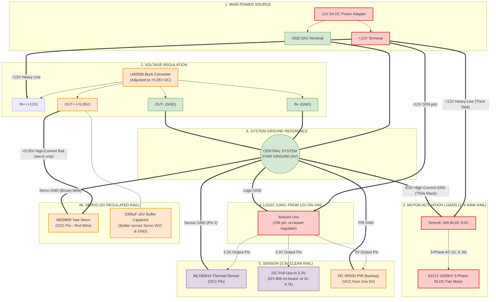
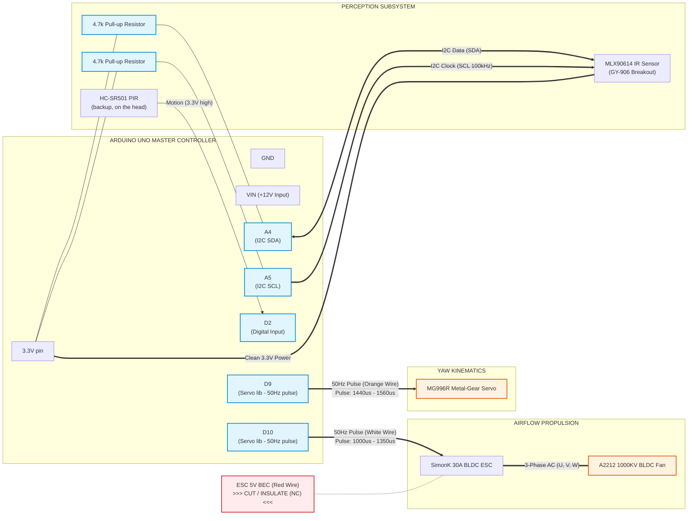

# Product Handoff Specification: Power & Control Architecture
## Autonomous Thermal-Tracking Pedestal Fan (Arduino Uno Platform)
**Target Audience:** Downstream AI Agent / Hardware Schematic Designer / CAD Engineer  
**Document Purpose:** Complete, unambiguous, zero-hallucination specification for generating production-ready **Power Distribution Diagrams** and **Signal Control Schematics**.  
**Controller note:** the original ESP32-S3 was replaced by an Arduino Uno (ATmega328P, 5 V logic). Behaviour is unchanged. Bench procedure: [`ARDUINO_UNO_BUILD_GUIDE.md`](ARDUINO_UNO_BUILD_GUIDE.md).  

> [!IMPORTANT]
> **No tilt, no motor driver:** the L298N and DC tilt motor have been removed. The only motors are the MG996R 360° servo (yaw) and the A2212 1000 KV BLDC (via the SimonK ESC). An HC-SR501 PIR on D2 is the backup sensor if the MLX90614 fails. Full wire list: [`COMPLETE_COMPONENT_CONNECTIONS_REFERENCE.md`](COMPLETE_COMPONENT_CONNECTIONS_REFERENCE.md).

---

## 1. System High-Level Architecture

The system is an autonomous, human-following pedestal fan that tracks occupant position via non-contact infrared thermal sensing and regulates 12V BLDC airflow velocity proportionally.

```
 +----------------------------------------------------------------------------------------------------+
 |                                    COMPLETE SYSTEM BLOCK TOPOLOGY                                  |
 +----------------------------------------------------------------------------------------------------+
 |                                                                                                    |
 |   12V 5A DC POWER SUPPLY                                                                           |
 |     |                                                                                              |
 |     +--> LM2596 BUCK (+5.05V) ------------------------------------> MG996R SERVO (+1000uF)         |
 |     |                                                                    ^ D9 pulse                |
 |     +--> ARDUINO UNO (VIN) ---- D9  ----------------------------------->-+                         |
 |     |     (master controller)  D10 ------------------------> SimonK ESC (white wire)               |
 |     |           |                                                  ^                               |
 |     |           +-- 3.3V pin + A4/A5 (I2C) --> MLX90614 SENSOR     |                               |
 |     |           +-- 5V pin + D2 ------------> HC-SR501 PIR (backup only)                           |
 |     |                                                              |                               |
 |     +--> SimonK 30A ESC (thick 12V leads) ------------------------+--> A2212 BLDC FAN (U,V,W)     |
 +----------------------------------------------------------------------------------------------------+
```

---

## 2. Power Architecture & Distribution Specification (For Power Diagram)

### 2.1 Voltage Domains & Netlist Definitions

The power distribution system consists of **3 strictly separated positive voltage rails** (plus the Uno's own internal 5 V) and a **single unified star ground reference**.

```
 +----------------------------------------------------------------------------------------------------+
 |                                        VOLTAGE BUS TABLE                                           |
 +----------------------------------------------------------------------------------------------------+
 | Net Name           | Voltage Range   | Source                 | Allowed Destination Loads          |
 +--------------------+-----------------+------------------------+------------------------------------+
 | +12V_RAW           | 11.8V - 12.4V DC| 12V 5A AC/DC Adapter   | LM2596 IN+, SimonK 30A +,          |
 |                    |                 |                        | Arduino Uno VIN                    |
 | +5V_SERVO          | 5.00V - 5.10V DC| LM2596 OUT+ (Tuned)    | MG996R VCC, 1000uF capacitor ONLY  |
 | +5V_UNO            | about 5.0V DC   | Uno on-board regulator | Uno logic; HC-SR501 PIR (backup)   |
 | +3V3_CLEAN         | 3.2V - 3.4V DC  | Uno 3.3V pin (150 mA)  | MLX90614 VIN, I2C pull-ups         |
 | SYSTEM_STAR_GND    | 0.0V Reference  | Power Supply Negative  | ALL Subsystem Ground Terminals     |
 +----------------------------------------------------------------------------------------------------+
```

### 2.2 Critical Power Design Rules (DOs and DON'Ts)

> [!CAUTION]
> **ABSOLUTE ELECTRICAL CONSTRAINTS FOR POWER DIAGRAM RENDERING:**
> 1. **DO NOT connect +12V_RAW to anything on the Uno except the `VIN` pin, and never to the MLX90614.** Maximum voltage on the MLX90614 is $3.6\text{V}$ (bare chip). Never feed 12 V into the Uno `5V` or `3.3V` pins.
> 2. **DO NOT connect the LM2596 output to the Uno.** The servo's $2.5\text{A}$ stall current must never share the Uno's 5 V rail. The Uno is powered from `VIN` (12 V) or USB.
> 3. **DO NOT connect the SimonK ESC Red BEC wire.** The internal 5V BEC on the ESC must be left disconnected and insulated to prevent back-powering circulating currents against the LM2596.
> 4. **DO NOT use an optocoupler.** A direct signal drive with common star ground is simpler, lower noise, and verified functional.
> 5. **DO connect all ground returns to a single Star Ground point.** High-current motor return paths must never run through breadboard tracks or the Uno's ground pins.
> 6. **DO place a $1000\,\mu\text{F}, 16\text{V}$ low-ESR electrolytic capacitor** directly across MG996R `VCC` (+5V) and `GND`.
> 7. **DO tie the I2C pull-ups to 3.3V, not 5V.** The Uno's internal 5 V pull-ups are disabled in firmware.

---

## 3. Signal & Control Specification (For Control Diagram)

### 3.1 Microcontroller Pin Allocation (Arduino Uno)

```
 +----------------------------------------------------------------------------------------------------+
 |                                  VERIFIED CONTROL PINOUT MATRIX                                    |
 +----------------------------------------------------------------------------------------------------+
 | Uno Pin      | Peripheral Connected         | Signal Class     | Electrical Specs                  |
 +--------------+------------------------------+------------------+-----------------------------------+
 | 3.3V         | MLX90614 VIN & I2C Pull-ups  | Power Output     | +3.3V DC, max 150mA (uses ~1.5mA) |
 | D9           | MG996R Servo Signal (Orange) | Servo pulse      | 5V TTL, 50Hz, 1.44-1.56ms in use  |
 | D10          | SimonK 30A ESC Signal(White) | Servo pulse      | 5V TTL, 50Hz, 1.0-1.35ms (capped) |
 | D2           | HC-SR501 PIR OUT (backup)    | Digital Input    | 3.3V high = motion                |
 | 5V           | HC-SR501 PIR VCC (backup)    | Power Output     | ~65 uA; empty if no PIR           |
 | A4 (SDA)     | MLX90614 SDA Line            | Open-Drain I2C   | pulled to 3.3V (GY-906 or 4.7k)   |
 | A5 (SCL)     | MLX90614 SCL Line            | Open-Drain I2C   | pulled to 3.3V (GY-906 or 4.7k)   |
 | D7 / D8      | (unused: tilt removed)       | —                | Leave free                        |
 | VIN          | 12V Adapter (+)              | Power Input      | 7-12V DC (12V adapter)            |
 | GND          | System Star Ground           | Power Ground     | 0V Reference                      |
 | D0 / D1      | (unused: USB serial)         | UART             | Keep free                         |
 +----------------------------------------------------------------------------------------------------+
```

### 3.2 Critical Control & Actuator Rules

> [!WARNING]
> **ABSOLUTE CONSTRAINTS FOR CONTROL DIAGRAM RENDERING:**
> 1. **SimonK ESC has NO I2C.** Never label the ESC with `SDA` or `SCL`. It has only 3 wires: White (signal), Black (GND), and Red (BEC +5V, Insulated).
> 2. **Motor 3-Phase AC lines ($U, V, W$) connect ONLY to the BLDC motor.** Never route motor phase wires back to the Uno (such as D0/D1).
> 3. **No duplicate BLDC driver.** Only ONE motor controller (SimonK 30A ESC) drives the primary 12V BLDC fan.
> 4. **No motor driver.** There is no tilt mechanism and no L298N; do not draw one.

---

## 4. Production-Ready Mermaid Code for Downstream Agent Rendering

The downstream agent can directly compile and render the following two Mermaid blocks into visual graphics without modification.

### 4.1 Master Power Distribution Diagram (Mermaid)



---

### 4.2 Master Signal Control Diagram (Mermaid)



---

## 5. Master ASCII System Schematics

### 5.1 Power Flow & Distribution Schematic

```
====================================================================================================
                                      MASTER POWER DISTRIBUTION
====================================================================================================

      12V 5A DC POWER ADAPTER
     +-----------------------+
     |   (+)           (-)   |
     +----|-------------|----+
          |             |
          +-------------|-------------------------------+
          |             |                               |
          +-------+     |                               |
          |       |     |                               |
          v +12V  v     |                               v (+12V)
     +----------+ +---------+                      +------------+
     |  LM2596  | | ARDUINO |                      | SimonK 30A |
     |   BUCK   | |   UNO   |                      |  BLDC ESC  |
     | STEPDOWN | |  (VIN)  |                      +-----+------+
     +----+-----+ +----+----+                            |
          |            |                                 | 3-Phase AC (U, V, W)
          | +5.05V     | 3.3V pin     5V pin             v
          | (servo     v                |         [A2212 BLDC FAN]
          |  only)  +----------+        v
          v         | MLX90614 |  +-----------+
     +----------+   |  SENSOR  |  | HC-SR501  |
     |  MG996R  |   +----+-----+  | PIR (bkp) |
     |  SERVO   |        |        +-----+-----+
     |(+1000uF) |        |              |
     +----+-----+        |              |
          |              |              |                       |
==========v==============v==============v=======================v====================
                                   SYSTEM COMMON STAR GROUND (0V)
=====================================================================================
```

### 5.2 Control Signals & Data Bus Schematic

```
====================================================================================================
                                      MASTER SIGNAL & DATA BUS
====================================================================================================

                                ARDUINO UNO
                           +---------------------+
                           |                     |
         [+3.3V Out] ----->| 3.3V                |
                           |                     |
                           |                 D9  |----[50Hz pulse]---------> MG996R Signal (Orange)
                           |                     |
                           |                 D10 |----[50Hz pulse]---------> SimonK ESC Signal (White)
                           |                     |
                           |                 D2  |<---[Motion in]---------- HC-SR501 OUT (backup)
                           |                     |
         [I2C SDA] <---*-->| A4 (SDA)            |
                       |   |                     |
         [I2C SCL] <---*-->| A5 (SCL)            |
                       | | |                     |
                       | | |                 VIN |<---[+12V from adapter]--- 12V Adapter (+)
                       | | |                 5V  |----[+5V out]------------> HC-SR501 VCC (backup)
                       | | |                 GND |<---[Common Star GND]----- Central Star Ground
                       | | +---------------------+
                       | |
                       | +---[ 4.7k Resistor ]---+
                       |                         |
                       +-----[ 4.7k Resistor ]---+
                                                 |
                                                 v
                                        +3.3V Rail (Uno 3.3V pin)
                                                 |
                              +------------------+----------+
                              | MLX90614 INFRARED SENSOR    |
                              |  Pin 1: VIN  <-- +3.3V Rail |
                              |  Pin 2: GND  <-- Common GND |
                              |  Pin 3: SCL  <-- Uno A5     |
                              |  Pin 4: SDA  <-- Uno A4     |
                              +-----------------------------+
```

---

## 6. Downstream Agent Checklist & Acceptance Criteria

When another agent generates the visual diagram deliverables, it must verify compliance against this checklist:

- [ ] **No 12V Logic Contamination:** The only 12V connection on the Uno is `VIN`. Zero traces connect +12V to the Uno `5V`/`3.3V` pins or to the MLX90614.
- [ ] **Servo rail isolated:** The LM2596 +5.05V output feeds the servo (and its capacitor) only, and is **not** connected to any Uno pin.
- [ ] **Sensor Powered at 3.3V:** The MLX90614 VCC connects strictly to the Uno `3.3V` pin.
- [ ] **I2C Pull-Ups Verified:** SDA (A4) and SCL (A5) are pulled up to the 3.3V rail, not 5V, by the GY-906's on-board resistors or two $4.7\text{k}\Omega$ resistors (never both).
- [ ] **No Motor Driver:** No L298N or tilt motor appears anywhere; D7/D8 are unconnected.
- [ ] **PIR Backup (if drawn):** HC-SR501 VCC on Uno 5V, OUT on D2, GND on star ground.
- [ ] **No ESC I2C:** The SimonK ESC shows only 1 signal input wire (White) on D10 and a Ground wire (Black).
- [ ] **ESC BEC Isolated:** The ESC Red wire is explicitly labeled as `NC / Insulated`.
- [ ] **Motor Phases Isolated:** ESC $U, V, W$ phases connect **exclusively** to the 3 motor terminals.
- [ ] **Servo Decoupling Indicated:** A $1000\,\mu\text{F}$ capacitor is depicted across Servo VCC & GND.
- [ ] **Common Star Ground:** All ground lines merge at a single Star Ground point.
- [ ] **No Optocoupler:** Signal from D10 routes directly to the ESC input.
